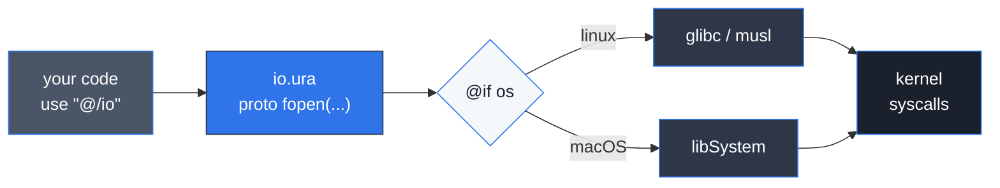
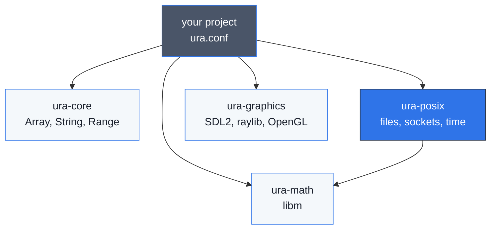

<p align="center">
  
</p>

<h1 align="center">ura-posix</h1>

<p align="center">
  The C library and the operating system for <a href="https://github.com/mohammedhrima/ura-lang">ura</a>: files, sockets, processes, time, signals.<br>
  Plain <code>proto</code> declarations, so every call goes straight to libc.
</p>

<p align="center">
  
  
  
  
  
</p>

---

## At a glance

```ura
use "@/io"
use "@/time"

fn main() i32:
    @if os == "linux":
        output("platform: linux\n")
    @else:
        output("platform: macOS\n")

    file i8[] = fopen("notes.txt", "w")
    fputs("ura calls libc directly\n", file)
    fputs("no wrappers, no glue code\n", file)
    fclose(file)

    line String
    line.resize(128)
    file = fopen("notes.txt", "r")
    count i32 = 0
    while fgets(line.data, 128, file) != null:
        count += 1
        output(count, " | ", line.data)
    fclose(file)
    remove("notes.txt")

    stamp i64 = 1767225600
    date String
    date.resize(64)
    strftime(date.data, 64, "%A %d %B %Y", gmtime(&stamp))
    output("2026 started on ", date.data, "\n")
    return 0
```

<table>
<tr><th>Output of <code>ura run</code></th><th>What it shows</th></tr>
<tr>
<td>

```
platform: linux
1 | ura calls libc directly
2 | no wrappers, no glue code
2026 started on Thursday 01 January 2026
```

</td>
<td>

- `@if os == "linux":` picks code at compile time
- `fopen`, `fputs`, `fgets`, `remove` are the C functions themselves
- a ura `String` lends its buffer to C through `.data`
- `fgets` returning `null` ends the loop
- `gmtime` + `strftime` turn a timestamp into a date

</td>
</tr>
</table>

## Install

```
ura install ura-posix 0.1.0 https://github.com/mohammedhrima/ura-posix
```

It adds this line to your project's `ura.conf`. `ura install` also gets ura-posix's own dependency, ura-math, inside it.

```ura
@dependency "ura-posix" "0.1.0" "https://github.com/mohammedhrima/ura-posix"
```

## From ura to the kernel



- Function declarations are the same on Linux and macOS, because C names them the same.
- The constants whose values differ between systems (`O_CREAT`, `O_TRUNC`, `O_APPEND`, `SIGUSR1`, `SIGCHLD`...) are written for both, as `@if linux:` / `@elif macos:` blocks. Those blocks are still commented out, so these constants aren't available yet. The constants that are the same everywhere (`O_RDONLY`, `SIGINT`, `ENOENT`...) work today.
- `i8[]` is a C pointer (`char *`, `FILE *`, `void *`), `i64` is `long` / `size_t` / `time_t` on 64-bit systems.

## API quick reference

| Module | Import | Key types and functions | Notes |
|---|---|---|---|
| io | `use "@/io"` | `fopen` `fgets` `fputs` `fread` `fwrite` `printf` `sprintf` `scanf` | 52 functions, the whole of `stdio.h` |
| net | `use "@/net"` | `socket` `bind` `listen` `accept` `connect` `send` `recv` `poll`, `Pollfd` | IPv4 and IPv6 helpers |
| stdlib | `use "@/stdlib"` | `exit` `getenv` `system` `rand` `atoi` `strtol` `qsort` | |
| string | `use "@/string"` | `strlen` `strcmp` `strcpy` `strstr` `strtok` `memcpy` `memset` | C strings; ura-core's `String` is separate |
| memory | `use "@/memory"` | `malloc` `calloc` `realloc` `free` `aligned_alloc` | |
| time | `use "@/time"` | `time` `clock_gettime` `gmtime` `strftime` `nanosleep`, `Tm` `Timespec` `Timeval` | |
| unistd | `use "@/unistd"` | `fork` `execvp` `pipe` `dup2` `close` `getcwd` `sleep` | plus `F_OK` `R_OK` `STDOUT_FILENO`... |
| fcntl | `use "@/fcntl"` | `open` `openat` `creat` `fcntl` | `O_RDONLY` `O_WRONLY` `O_RDWR` |
| dirent | `use "@/dirent"` | `opendir` `readdir` `closedir` | |
| stat | `use "@/stat"` | `stat` `fstat` `mkdir` `chmod` `umask` | `S_IFDIR` `S_IFREG`... |
| signals | `use "@/signals"` | `signal` `raise` `kill` `sigaction` | `SIGINT` `SIGTERM` `SIGSEGV`... |
| errno | `use "@/errno"` | `strerror` `perror` | `ENOENT` `EACCES` `EINVAL`... |
| ctype | `use "@/ctype"` | `isalpha` `isdigit` `isspace` `toupper` `tolower` | |
| common | `use "@/common"` | `printf` `calloc` `free` `write` `exit` `strlen` `getenv` | the few calls most programs need |
| header | `use "@/header"` | every module above, and ura-math | one line to get everything |

<details>
<summary><b>io</b>: 52 functions</summary>

`fopen` `freopen` `fclose` `fflush` `fgetc` `fputc` `getc` `putc` `getchar` `putchar` `ungetc` `fgets` `fputs` `puts` `gets` `fread` `fwrite` `write` `read` `fseek` `ftell` `rewind` `fgetpos` `fsetpos` `feof` `ferror` `clearerr` `perror` `setvbuf` `setbuf` `remove` `rename` `tmpfile` `tmpnam` `fileno` `fdopen` `printf` `fprintf` `sprintf` `snprintf` `dprintf` `vprintf` `vfprintf` `vsprintf` `vsnprintf` `vdprintf` `scanf` `fscanf` `sscanf` `vscanf` `vfscanf` `vsscanf`

</details>

<details>
<summary><b>net</b>: sockets, addresses, polling</summary>

`socket` `bind` `listen` `accept` `connect` `shutdown` `send` `recv` `sendto` `recvfrom` `sendmsg` `recvmsg` `setsockopt` `getsockopt` `getsockname` `getpeername` `htons` `htonl` `ntohs` `ntohl` `inet_addr` `inet_ntoa` `inet_pton` `inet_ntop` `gethostbyname` `gethostbyaddr` `getaddrinfo` `freeaddrinfo` `gai_strerror` `getnameinfo` `select` `poll` `ioctl`

Types and constants: `Pollfd`, `IPPROTO_IP` `IPPROTO_TCP` `IPPROTO_UDP` `IPPROTO_IPV6`, `SHUT_RD` `SHUT_WR` `SHUT_RDWR`, `POLLIN` `POLLPRI` `POLLOUT` `POLLERR`...

</details>

<details>
<summary><b>stdlib, string, memory</b></summary>

**stdlib**: `abort` `exit` `quick_exit` `_Exit` `getenv` `setenv` `unsetenv` `putenv` `system` `rand` `srand` `bsearch` `qsort` `abs` `labs` `div` `ldiv` `atoi` `atol` `atof` `strtol` `strtoul` `strtof` `strtod` `strtoll` `strtoull` `mblen` `mbtowc` `wctomb` `mbstowcs` `wcstombs`

**string**: `strlen` `strnlen` `strcmp` `strncmp` `strcasecmp` `strncasecmp` `strcoll` `strxfrm` `strcpy` `strncpy` `strdup` `strndup` `strcat` `strncat` `strchr` `strrchr` `strstr` `strcasestr` `strspn` `strcspn` `strpbrk` `strtok` `strtok_r` `strerror` `strerror_r` `memchr` `memrchr` `memcmp` `memcpy` `memmove` `memset` `memccpy` `bzero` `strlcpy` `strlcat` `strsignal` `memset_s`

**memory**: `malloc` `calloc` `realloc` `free` `aligned_alloc`

</details>

<details>
<summary><b>time, unistd, fcntl, dirent, stat</b></summary>

**time**: `time` `difftime` `clock` `gmtime` `localtime` `mktime` `gmtime_r` `localtime_r` `strftime` `asctime` `ctime` `asctime_r` `ctime_r` `clock_gettime` `clock_settime` `nanosleep` `gettimeofday`; structs `Tm`, `Timespec`, `Timeval`

**unistd**: `getpid` `getppid` `getuid` `geteuid` `getgid` `getegid` `setuid` `setgid` `fork` `execv` `execve` `execvp` `_exit` `getcwd` `chdir` `fchdir` `access` `unlink` `rmdir` `symlink` `readlink` `rename` `truncate` `ftruncate` `close` `dup` `dup2` `pipe` `lseek` `isatty` `ttyname` `sleep` `usleep` `gethostname` `sethostname` `alarm` `pause` `sync` `fsync` `fdatasync`; constants `F_OK` `X_OK` `W_OK` `R_OK` `SEEK_SET` `SEEK_CUR` `SEEK_END` `STDIN_FILENO` `STDOUT_FILENO` `STDERR_FILENO`

**fcntl**: `open` `openat` `creat` `fcntl`; `O_RDONLY` `O_WRONLY` `O_RDWR` `FD_CLOEXEC`

**dirent**: `opendir` `fdopendir` `closedir` `readdir` `rewinddir` `telldir` `seekdir`

**stat**: `stat` `fstat` `lstat` `mkdir` `chmod` `fchmod` `umask`; `S_IFMT` `S_IFSOCK` `S_IFLNK` `S_IFREG` `S_IFBLK` `S_IFDIR` `S_IFCHR` `S_IFIFO` `S_ISUID` `S_ISGID` `S_ISVTX`

</details>

<details>
<summary><b>signals, errno, ctype, common</b></summary>

**signals**: `signal` `raise` `kill` `sigaction` `sigprocmask` `sigsuspend` `strsignal`; `SIGHUP` `SIGINT` `SIGQUIT` `SIGILL` `SIGTRAP` `SIGABRT` `SIGFPE` `SIGKILL` `SIGSEGV` `SIGPIPE` `SIGALRM` `SIGTERM`

**errno**: `strerror` `strerror_r` `perror`; `EPERM` `ENOENT` `ESRCH` `EINTR` `EIO` `ENXIO` `E2BIG` `ENOEXEC` `EBADF` `ECHILD` `EACCES` `EFAULT` `EBUSY` `EEXIST` `ENOTDIR` `EISDIR` `EINVAL` `ENFILE` `EMFILE` `ENOSPC` `EROFS` `EPIPE` `EDOM` `ERANGE`...

**ctype**: `isalnum` `isalpha` `isascii` `isblank` `iscntrl` `isdigit` `isgraph` `islower` `isprint` `ispunct` `isspace` `isupper` `isxdigit` `tolower` `toupper`

**common**: `printf` `dprintf` `calloc` `free` `write` `exit` `strlen` `getenv`, and `Os`

</details>

## The ura standard library



| Repo | Version | What | Depends on |
|---|---|---|---|
| [ura-core](https://github.com/mohammedhrima/ura-core) | 0.1.0 | Array, String, Range, Error, Os | nothing |
| **ura-posix** | 0.1.0 | the C library and the OS | ura-math |
| [ura-math](https://github.com/mohammedhrima/ura-math) | 0.1.0 | C's math library | nothing |
| [ura-graphics](https://github.com/mohammedhrima/ura-graphics) | 0.1.0 | SDL2, raylib, OpenGL | nothing |

---

<p align="center">
  Part of <a href="https://github.com/mohammedhrima/ura-lang">ura-lang</a>
</p>
