# PharmaGest

Web dashboard for Moroccan pharmacies: import Sobrus CSV exports, get reports, margins, stock alerts
and accounting views. Backend FastAPI + Postgres 17, frontend React + Vite + Tailwind.

| File | What |
|---|---|
| `README.md` | this file: the product, how it is built, how to run, test and deploy it |
| `.claude/CLAUDE.md` + `.claude/rules/*.md` | rules for every change (answers, commands, product rules, code style, git) |
| `PLAN.md` | what is left to do (open items only) |

If this file and the code disagree, **the code wins**, then fix this file. Diagrams are
[Mermaid](https://mermaid.js.org): GitHub and VS Code draw them.

## Contents
1. [The product](#1-the-product)
2. [Architecture](#2-architecture)
3. [Repository map](#3-repository-map)
4. [Run it locally](#4-run-it-locally)
5. [Backend](#5-backend)
6. [Frontend](#6-frontend)
7. [Domain rules and locked formulas](#7-domain-rules-and-locked-formulas)
8. [Tests: the Playwright E2E suite](#8-tests-the-playwright-e2e-suite)
9. [Deployment (DigitalOcean)](#9-deployment-digitalocean)
10. [How-to checklists](#10-how-to-checklists)

---

## 1. The product

Pharmacists export their data from **Sobrus** (their pharmacy software) as CSV files, import them
here, and read their numbers. Users are **not tech-savvy**: every screen has plain words, one obvious
action and big targets.

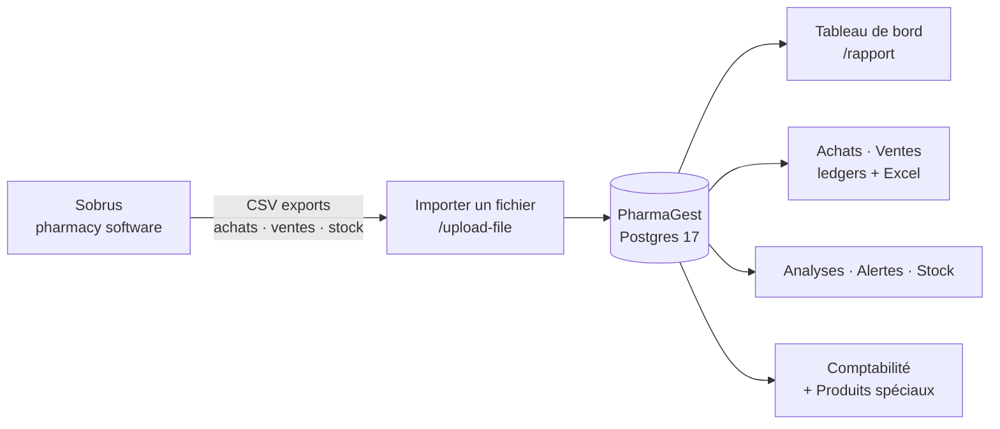

**Languages:** French (default) ⇄ Spanish, every text from `fr.ts` + `es.ts`, server errors included
(the backend sends a `code`, the page shows `errors.<code>`). **Money:** MAD only (currency per pharmacy
is in `PLAN.md` « Later »).

### Roles (`User.role`)
| Role | Who | Sees |
|---|---|---|
| `admin` | Platform staff | Every pharmacy and account. Manages pharmacies, users, catalogue, category suffixes. Uses `/v1/admin/*`; pharmacy pages are closed to admins. |
| `owner` | Pharmacy owner | Their pharmacy's data. Manages their team (« Gérer mon équipe »). A pharmacy can have several owners. |
| `employee` | Pharmacy staff | Their pharmacy's data, limited by the owner. |
| `developer` | APCM developer | Only the hidden « Ma boutique en ligne » feature. |

### Features (permission keys, `ALLOWED_FEATURES` in `app/core/models.py`)
`rapports`, `import`, `achats`, `ventes`, `stock`, `analyse`, `accounting`, `alertes`,
`special_products`. A new pharmacy / user gets every feature. Who sees what: [§5.4](#54-permissions-3-layers).

### Pages
| Route | Page | Feature |
|---|---|---|
| `/rapport` | Tableau de bord: KPIs, trend, categories, margin alerts, TVA, stock tiles | `rapports` |
| `/achats` | Purchases ledger (bons de livraison) | `achats` |
| `/ventes` | Sales ledger + « à surveiller » tabs | `ventes` |
| `/stock` | ABCD rotation + péremptions (expiry) | `stock` |
| `/analyses` | Analyse de marge: produit, catégorie, laboratoire, grossiste, client, mois, année, liste | `analyse` |
| `/alertes` | Margin alerts, ventes sans achat, stock and expiry alerts | `alertes` |
| `/comptabilite` | Accounting KPIs (exclusions applied), payment methods per month, sales journal | `accounting` |
| `/produits-speciaux` | Leave products / BLs / suppliers out of Comptabilité | `special_products` |
| `/upload-file`, `/imports` | Import wizard, import history (cancel / delete) | `import` |
| `/owner/employees` | Gérer mon équipe | role `owner` |
| `/admin/pharmacies` (+ `/:id`) | Pharmacies et utilisateurs: tabs Pharmacies · Utilisateurs · Demandes (N) (sign-ups to accept); one pharmacy: info, features, members | role `admin` |
| `/admin/catalogue`, `/admin/categories` | Global catalogue (CRUD + CSV import); category → reference suffix | role `admin` |
| `/auth/me` | Mon compte: profile, password, sessions | any logged-in user |
| `/login`, `/auth/signup`, `/auth/forgot-password`, `/auth/set-password` | Auth (guests only); `/auth/signup` = « Créer un compte » | none |

No access to a page → 404 inside the layout (the sidebar stays).

**Privacy (client rule):** nobody may learn which pharmacies use PharmaGest. No public list of pharmacies,
a pharmacy is joined only by typing its code (`CAS0001`), and public answers never say whether a code or an
email exists (sign-up always answers « Demande envoyée », forgot-password always 200).

### Glossary
| Term | Meaning |
|---|---|
| Achat | One purchase line (one product on a delivery note), table `achats` |
| Vente | One sale line (one product on a ticket), table `ventes` |
| BL (bon de livraison) | Delivery note, `Achat.delivery_ref`. Achats only; the ventes equivalent is the ticket (`Vente.transaction_ref`, « FAC-… ») |
| Fournisseur: grossiste / laboratoire | Supplier: wholesaler / direct lab ([§7.4](#74-analyses-axes)) |
| PPH · PU · PPV | Catalogue purchase price · real unit purchase price after discount · public selling price |
| Remise | Discount (percent) |
| CA (chiffre d'affaires) | Sales revenue |
| TVA | VAT (0 %, 7 %, 20 % in the data) |
| Péremption | Expiry date |
| Produits spéciaux | Products the owner leaves out of Comptabilité |
| Pharmacie / Parapharmacie / Mixte | Medicine / non-medicine / both |

---

## 2. Architecture

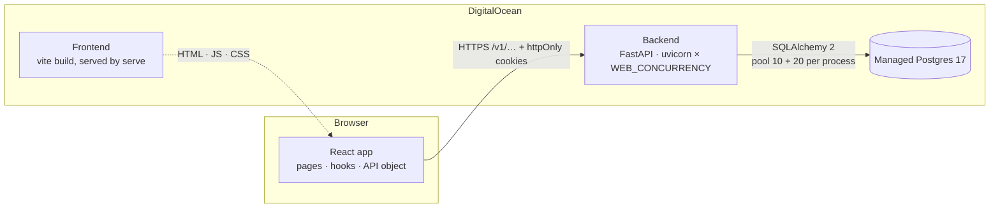

| Part | Stack |
|---|---|
| Backend | Python 3.12, FastAPI, SQLAlchemy 2 (sync), Alembic, slowapi, uv. Postgres extensions `pg_trgm`, `unaccent` |
| Frontend | React 19 + **React Compiler**, Vite 8, TypeScript, TanStack Query 5, Tailwind 4, react-router 7, react-hook-form + zod, sonner, lucide-react, xlsx |
| Tests | Playwright E2E on the production Docker images + a Python oracle ([§8](#8-tests-the-playwright-e2e-suite)) |

---

## 3. Repository map

```
apcm-pharma/
├── README.md · PLAN.md        this file · what is left to do
├── .claude/                   rules: CLAUDE.md + rules/ (architecture, frontend code style, git)
├── TODO.md                    owner's personal notes (not part of the plan)
├── Makefile                   every command (make help)
├── docker-compose.yml         demo stack: db (Postgres 17) + backend + frontend
├── .prettierrc.json           Prettier width 120 (make format)
├── env/demo/docker.env        demo env, copied to .env by make db / make demo
├── resources/
│   ├── catalog.csv            real Sobrus catalogue sample, used by seed
│   ├── khutna/, les-joyeux/   real Sobrus exports of 2 pharmacies (samples)
│   └── tests/                 E2E data generator + oracle (§8)
├── e2e/                       Playwright suite (§8)
├── backend/                   FastAPI (§5)
│   ├── main.py                the app: middlewares + routers (deployments run main:app)
│   ├── app/                   all code, one folder per business area (§5.1)
│   ├── scripts/               bootstrap.py (schema), seed.py + seed.json, one-time legacy migration
│   ├── alembic/versions/      migrations 0001 → 0023 (head)
│   ├── entrypoint.sh          container boot (§9)
│   ├── Dockerfile · .env.example
│   └── pyproject.toml         deps + ruff (line-length 120)
└── frontend/                  React (§6)
    ├── vite.config.ts         React Compiler, Tailwind, `@` alias, /v1 dev proxy
    ├── Dockerfile             build with VITE_BACKEND_URL, serve dist on :4173
    └── src/
        ├── main.tsx · App.tsx  providers · routes + guards
        ├── api/                client.ts, api.ts (every call), errors.ts (error codes)
        ├── _components/        shared UI (AppLayout, DataTable, filterBar, KpiTile, Page, …)
        ├── hooks/              app-wide hooks (useMe, sharedQueries, useListFilters, UploadContext, …)
        ├── pages/              one folder per area, then one per route (§6.3)
        ├── i18n/               I18nProvider (useT) + locales/fr.ts, es.ts
        ├── types/              one file per backend area, import from "@/types"
        ├── utils/              format.tsx, text.ts, csv.ts, table.ts, dateRange.ts, cn.ts
        └── styles/             tokens.css (colors), globals.css
```

---

## 4. Run it locally

Needs Docker (Postgres), `uv` (Python 3.12), Node 20+.

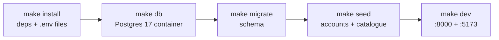

| Command | What it does |
|---|---|
| `make install` | `uv sync` + `npm install`; creates `backend/.env` (random `JWT_SECRET`) and `frontend/.env` if missing |
| `make db` | starts Postgres 17 (volume `pg17_data`) and creates the dev DB `apcm` |
| `make migrate` | `scripts/bootstrap.py`: extensions, `immutable_unaccent()`, migrations |
| `make seed` | seed accounts + « Pharmacie Demo » + catalogue (idempotent) |
| `make dev` | backend uvicorn **:8000** (hot reload, applies new migrations first) + Vite **:5173** |
| `make backend` · `make frontend` | one of the two |
| `make format` | Prettier (frontend + e2e) + ruff (backend), width 120 |
| `make build` | backend Docker image + `tsc -b && vite build` |
| `make demo` · `make down` · `make logs` | full Docker stack (app **:4173**) · stop · logs |
| `make clean` | **destroys every DB volume** |
| `make tests` · `make tests-ui` | E2E ([§8](#8-tests-the-playwright-e2e-suite)) |

### Seed accounts (`backend/scripts/seed.json`)
| Email | Password | Role |
|---|---|---|
| admin@gmail.com | admin@123 | admin |
| owner@gmail.com | owner@123 | owner of « Pharmacie Demo » (Casablanca, `CAS0001`, every feature) |
| dev@gmail.com | dev@123 | developer |

### Environment variables
**Backend** (`backend/.env`, read by `app/core/config.py`, documented in `backend/.env.example`):
| Var | Notes |
|---|---|
| `DATABASE_URL` | `postgresql+psycopg2://…` (dev: `apcm:apcm@localhost:5432/apcm`) |
| `JWT_SECRET` | ≥ 32 chars, not a placeholder: the app refuses to start otherwise |
| `JWT_ACCESS_EXPIRY_MIN` | default 7 days |
| `COOKIE_SECURE` | `true` in production (HTTPS) |
| `FRONTEND_URL` | exact CORS origin + base of the password links |
| `MAIL_USERNAME`, `MAIL_PASSWORD`, `MAIL_FROM`, `MAIL_SERVER`, `MAIL_PORT`, `MAIL_STARTTLS`, `MAIL_SSL_TLS` | SMTP. Empty `MAIL_USERNAME` → links are **printed to the log** |
| `WEB_CONCURRENCY` | uvicorn processes in Docker (default 2) |
| `PORT` | container port (default 8000) |
| `RATE_LIMIT=0`, `SEED_CATALOG=0` | **E2E only**: no login limit, no catalogue in the seed |

**Frontend** (`frontend/.env`): `VITE_BACKEND_URL` (dev `http://localhost:8000`), read at **build time**.

---

## 5. Backend

### 5.1 Layout: one folder per business area

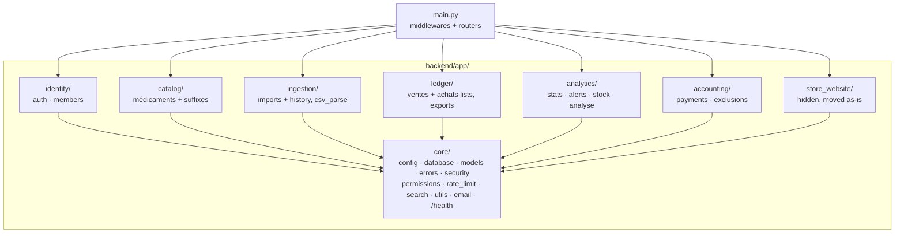

| Rule | Example |
|---|---|
| One area = `router.py` + `schemas.py` (+ `service.py` / `*_queries.py`) | `app/catalog/router.py` + `app/catalog/schemas.py` |
| Heavy SQL in `*_queries.py`; the router reads params → calls → returns the schema | `app/analytics/stats_queries.py` |
| Imports always absolute from `app` | `from app.core.models import User` |
| Shared SQL pieces | `app/analytics/query_parts.py`: `Filters`, `ca_sum()`, `avg_pu_subquery()`, `PRICED_PURCHASE`, `category_filter()` |

### 5.2 One request, start to end

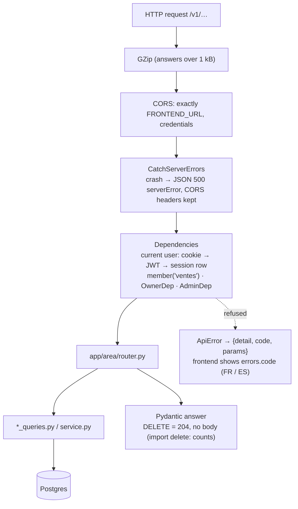

- Every route is under `/v1` (106 routes). `/openapi.json` + `/docs` are outside `/v1`.
- Errors: `raise ApiError(404, ErrorCode.BL_NOT_FOUND, "French detail", ref=ref)` (`app/core/errors.py`).
  `detail` stays French for logs; the user reads `errors.<code>` from `fr.ts` / `es.ts`.
- Lists answer `{data, pagination: {page, limit, total, total_pages}, summary?}`; export = the same list
  with `export=true` (capped at 50 000 rows → 413).

### 5.3 Data model (`app/core/models.py`)

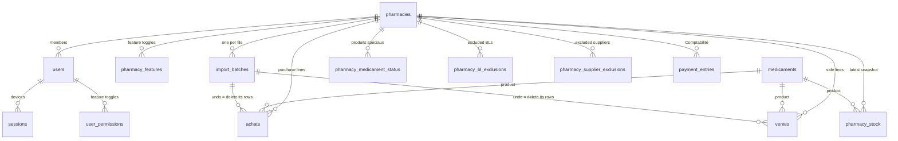

| Table | Holds |
|---|---|
| `pharmacies` | name, city, code (`CAS0001`, from the city), address, phone, email, `archived_at` |
| `users` | email, name, role, status (`active` / `inactive`), `pharmacy_id`, `token_version`, hashed reset token |
| `sessions` | one row per logged-in device |
| `signup_requests` | « Créer un compte » waiting for the admin (`pending` / `accepted` / `refused`), kept out of `users` so nobody logs in before « Accepter » |
| `medicaments` | **one global catalogue**: `pid` (Sobrus id, unique), product, tva, pph, ppv, category, zone, barcodes, laboratoire, `product_type` |
| `import_batches` | one row per imported file: type, counts, status, `last_chunk_at`, creator, soft delete |
| `achats` | purchase lines: `delivery_date`, `delivery_ref` (BL), supplier, quantity, unit_price (PU), total, expiry, `created_at_source` |
| `ventes` | sale lines: `date`, `transaction_ref`, client, quantity, discount (%), unit_price, total |
| `pharmacy_stock` | latest stock per (pharmacy, medicament), UPSERTed by stock imports |
| `category_suffixes` | category → reference suffix + color (shown on ventes / achats refs) |
| `store_website_*` | hidden « Ma boutique en ligne » |

Dates in `achats` / `ventes` are **ISO text** (`"2026-01-15"`, `"2026-01-15 14:19:00"`), always written
by `csv_parse.normalize_date` / `normalize_datetime`: period filters compare text.

### 5.4 Permissions (3 layers)

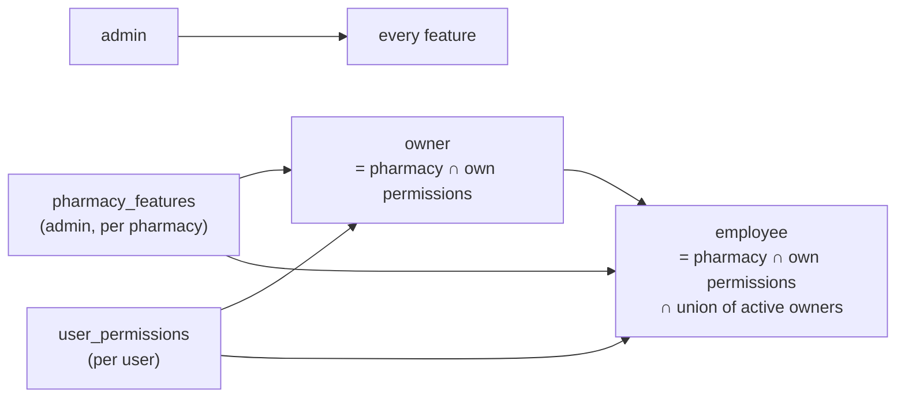

- Guards are FastAPI dependencies in the signature, never code in the body:
  `pharmacy_id: Annotated[int, member("import", "achats")]`, `MemberDep`, `OwnerDep`, `user: AdminDep`,
  `APIRouter(dependencies=[admin_only])`.
- The frontend mirrors it: `/auth/me` returns `permissions`, `RequireFeature` shows the in-layout 404,
  the sidebar hides entries.

### 5.5 Auth (`app/core/security.py`, `app/identity/auth/`)

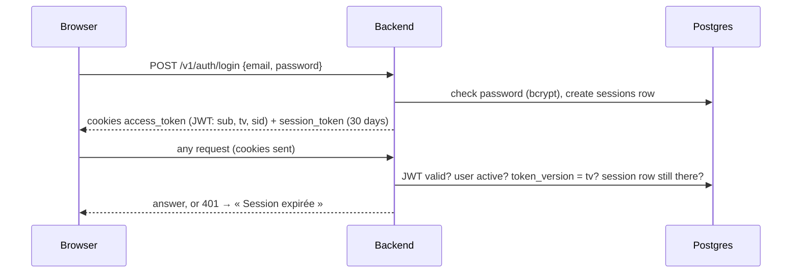

- Password change / reset / deactivation bump `token_version`: every JWT dies (change-password keeps
  the current device logged in). Removing a session row logs that device out at once.
- Emails are stored and compared trimmed + lower case (`normalize_email`): `Ali@Gmail.com` = `ali@gmail.com`.
- Forgot password: always 200, 60-min hashed token, link `FRONTEND_URL/auth/set-password?token=…`.
- Rate limits (slowapi, in memory, per process): login **5/min**, forgot-password **3/hour**, sign-up **5/hour** per IP.

**Sign up (« Créer un compte », `/auth/signup`)**: 5 short screens, like Gmail (who you are → your pharmacy or its
code → name + phone → email → password twice), then the admin decides:

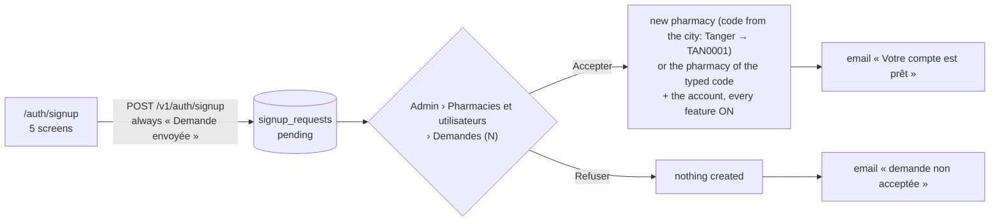

- Owner: a new pharmacy (name + city) or an existing one (its code). Employee: always a code.
- « Accepter » is greyed out, with the reason, when the email already has an account or no pharmacy has the code.

### 5.6 Routers (all under `/v1`)
| File | Main routes | Guard |
|---|---|---|
| `core/health.py` | `GET /health` | none |
| `identity/auth/router.py` | `/auth/login`, `/auth/signup`, `/auth/me`, `/auth/change-password`, `/auth/logout`, `/auth/forgot-password`, `/auth/validate-token`, `/auth/set-password`, `/sessions…` | cookie (signup, forgot, login: none) |
| `identity/members/admin_router.py` | pharmacies CRUD (`DELETE` = archive), features, users, `GET /admin/users`, `/admin/signup-requests` (+ `/{id}/accept`, `/{id}/refuse`) | admin |
| `identity/members/owner_router.py` | `/owner/employees…` (invite, permissions, status, reset, delete) | owner |
| `catalog/router.py` | `/admin/catalog…`, `/category-suffixes…` | admin |
| `ingestion/router.py` | `/uploads/{achat,vente,stock}-json`, `PATCH /uploads/batches/{id}`, `/uploads/catalog`, `/data/imports` | import + type |
| `ledger/router.py` | `/ventes…`, `/achats…` (lists, categories, tva, suggestions, summaries, export) | ventes / achats |
| `analytics/router.py` | `/stats`, `/stats/margin-alerts`, `/ventes-sans-achat`, `/stock-summary`, `/stock-abcd`, `/peremptions`, `/analyse-marge`, `/analyse-liste`; admin `/admin/stats`, `/admin/pharmacy/{id}/stats…` | rapports / alertes / stock / analyse; admin |
| `accounting/payments/router.py` | `/accounting/payments` | accounting |
| `accounting/exclusions/router.py` | `/special-products/…`, `/bl-exclusions/…`, `/supplier-exclusions/…` | special_products |
| `store_website/router.py` | `/store-website/*` (hidden) | owner / developer |

### 5.7 Import pipeline

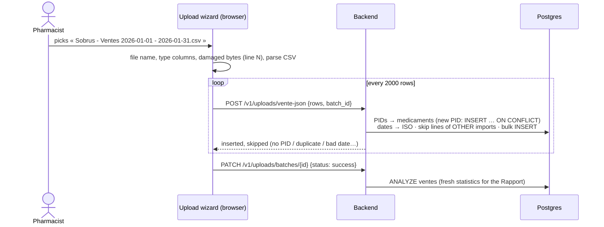

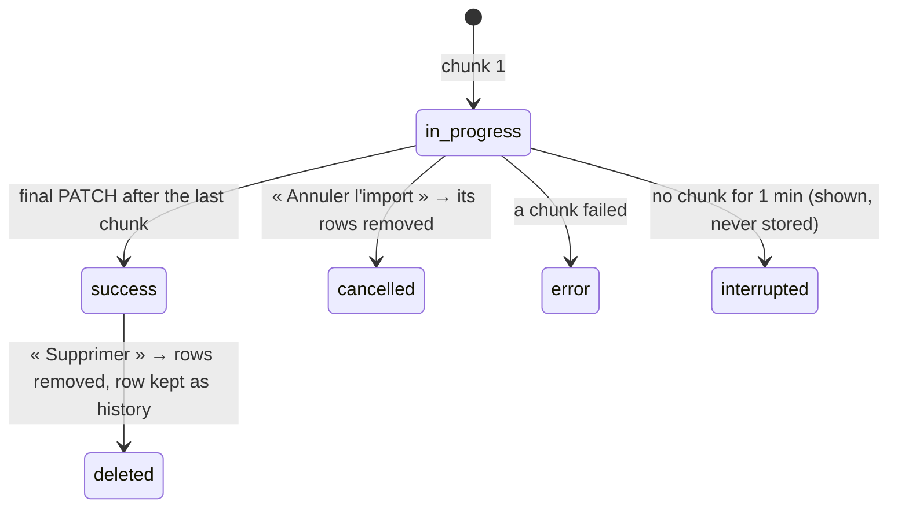

| Rule | Example |
|---|---|
| A line is skipped only if **another** import already stored the same (BL or ticket, product) | same file twice → 0 added; BL with lot A ×10 + lot B ×5 → 15 stored |
| New PID with an existing **normalized name** (unaccent, lower, single spaces) merges onto that product | « Doliprane  1000 » = « DOLIPRANE 1000 » |
| Dates saved by hand are read day first | `23/1/26`, ` 05/02/2026 `, `23.01.2026 14:19` → `2026-01-23` |
| Impossible date on a vente / BL date → line not imported, counted, explained | `31/02/2026` → « 1 ligne(s) non importée(s) : date illisible … » |
| Damaged file (NUL / control character) → refused before anything is written | `fileCorrupted` |
| Stock = UPSERT per (pharmacy, medicament) | can't be undone |
| Admin catalogue CSV (`Nom,Categorie,TVA,PPV,PPH,Code barre 1,Code barre 2,Laboratoire`) | sets `product_type` from the category |

### 5.8 Schema and migrations
- `scripts/bootstrap.py` (`make migrate` + container start): `CREATE EXTENSION pg_trgm, unaccent` →
  `immutable_unaccent()` (schema-qualified) + self-check under `search_path = pg_catalog, pg_temp` →
  fresh DB: `create_all` + `alembic stamp head`; managed DB: `alembic upgrade head`.
- Head **0023** (0020: `import_batches.last_chunk_at`; 0021: dates already stored rewritten as ISO;
  0022: emails stored trimmed + lower case; 0023: `signup_requests`).
- A new column needs **both** the model change and a migration (fresh DBs use `create_all`).

---

## 6. Frontend

### 6.1 From a page to the backend

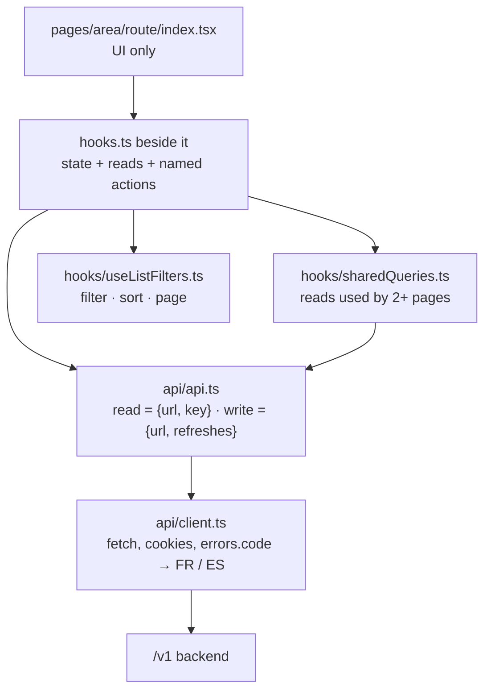

- **After a write**: `refresh(qc, API.x.write)` refreshes every read it lists. After an import or an
  undo, every read fed by that data is refreshed too.
- Hooks return named state + actions (`{ deletePayment, isDeleting }`), never the raw `useQuery` /
  `useMutation`.
- `main.tsx` providers: `QueryClientProvider` (no retry, no refetch on focus) → `I18nProvider` →
  `UploadProvider` → `GlobalDateRangeProvider` → router → `App`, plus `SessionExpiredDialog` and the
  toaster. Any failed query / write without its own handler → error toast.
- `App.tsx`: guest routes in `RequireGuest`; app routes in `AppLayout` (→ `/login` if `/auth/me`
  fails); `RequireFeature` / `RequireRole` show the in-layout 404. Every page loads on first visit
  (`React.lazy`); the others are prefetched 2 s after the first screen.

### 6.2 React Compiler
On: it memoizes every component it can compile. A component with a `react-hooks` lint error is skipped,
so the E2E gate requires **0** of them (`npx eslint src` in `frontend/`). Rules:
`.claude/rules/frontend-code-style.md`.

### 6.3 Where things go
| Used by | Goes in |
|---|---|
| 1 page | that page's `index.tsx` / `hooks.ts` / `_components/` |
| several routes of 1 area | `pages/area/_components/` or `pages/area/hooks.ts` |
| several areas | `src/_components/` (`Page`, `DataTable`, `filterBar`, `KpiTile`, `GaugeTiles`, `FormField`, `MembersSection`, `ConfirmDialog`, `TabBar`, `Checkbox`, …) |

Every page uses `Page` (same title block and width). Lists use `filterBar` (search, period,
Mixte / Pharmacie / Parapharmacie, selects, chips) + `DataTable`.

### 6.4 Text, numbers, exports
- Text: `t("section.key", {var})` from `fr.ts`; `es.ts` must have the same keys (TypeScript checks).
- Numbers and dates: `utils/format.tsx` only (`formatMAD`, `formatQty`, `formatPct` = 2 decimals +
  comma, `formatDate`, `formatDateTime`, `formatNumStr`). Never `toFixed` / `toLocaleString` in a page.
- Search boxes: `utils/text.ts` `matchesFields` (same grammar as the backend, [§7.7](#77-search-every-search-box)).
- Excel: `.xlsx` via `utils/table.ts`, French headers.

---

## 7. Domain rules and locked formulas

**Ask before changing any of these.** The E2E oracle re-computes each one ([§8](#8-tests-the-playwright-e2e-suite)).

### 7.1 Prices, CA, margins
| Formula | Example |
|---|---|
| PU = PPH × (1 − remise) = `Achat.unit_price` | PPH 100, remise 10 % → PU 90 |
| **CA = Σ qty × PPV** (`coalesce(PPV, Vente.unit_price)`), on **every** screen (`ca_sum()`) | 10 sold at PPV 20, ticket with 10 % off → CA 200 |
| **Marge % = (1 − PU / PPV) × 100**. Never `PPV − PPH` (PPH often = PPV → fake 0 %) | PU 90, PPV 120 → 25 % |
| Average PU = Σ(PU × qty) / Σ qty, lines with a price and qty > 0 (`PRICED_PURCHASE`); PU 0 (free units) counts | 10 bought at 20 + 2 free → 16,67 |
| Window: margin alerts, ledger marge cells use achats **in the period**; top categories use all-time PU | |
| No PU in the window → product left out of the margin (no PPH fallback) | |
| Marge nette = HT/HT, grouped by TVA: (PPV − PU) / (1 + TVA) | |
| `reconcile_marge_to_ca`: marge brute = CA × marge % / 100, nette scaled the same way | every page shows the same margin |

### 7.2 Pharmacie vs Parapharmacie (`pharma_expr()`)
`Medicament.product_type` wins; else a category containing « médicament », « homéopathie » or
« diététique » (accents optional) → pharmacie; else parapharmacie.

### 7.3 Exclusions (Produits spéciaux page)

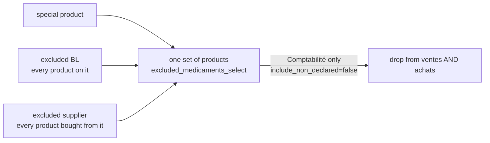

- Every other page includes everything. Comptabilité sends `include_non_declared=false`, the Rapport
  `true`. API defaults when the param is missing: `/stats` → exclusions on, `/ventes`, `/achats` → off.
- Manual payment-method amounts are never excluded.

### 7.4 Analyses axes
- **Grossiste** = a supplier whose upper-case name starts with `GROSSISTE`; **Laboratoire** = every other
  named supplier.
- A product bought from several suppliers **splits its sales by units bought** in the period. Each
  supplier's margin uses its own PU; both tabs together = the sales counted once.

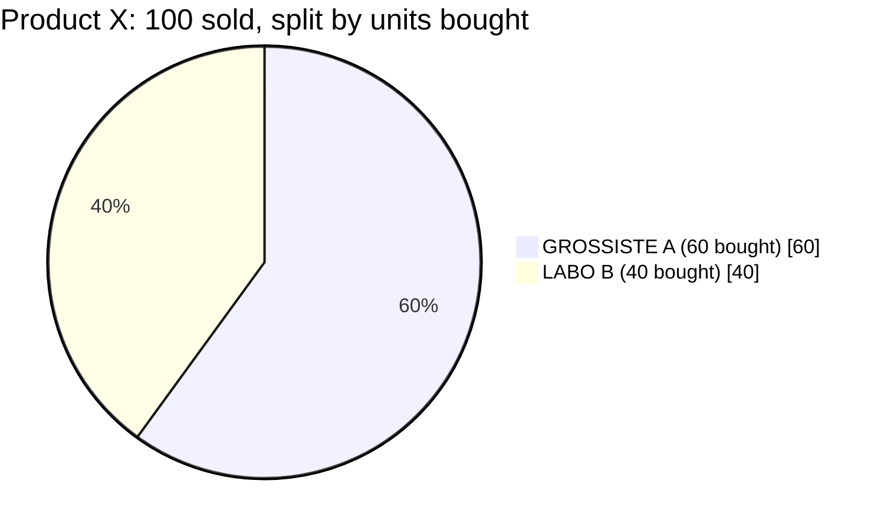

- Catégorie mode: « Médicament (33.930%) » and « Médicament (30.000%) » are one « Médicament » row.

### 7.5 Stock (`stock_queries.py`)
| Rule | Value |
|---|---|
| MIN / MAX | round(sales_12m / 300 × 14) / round(sales_12m / 300 × 15) |
| Coverage days = stock × 365 / sales_12m | ≤ 45 sous-stock · ≤ 60 idéal · ≤ 99 à surveiller · else sur-stock; `negatif` if stock < 0; `inconnu` without 12-month sales |
| ABCD by units sold in 12 months | ≥ 300 A · ≥ 250 A- · ≥ 200 B+ · ≥ 48 B · ≥ 6 C · 1–5 C- (C-N if sold only in the last 4 months) · 0 D |
| Default window | Jan–Jun → previous calendar year; Jul–Dec → Jul (Y-1) → Jun (Y) |
| Rapport stock tiles | sous-stock if stock < MIN, sur-stock if > MAX; « santé » = (in band + sur) / classified |
| Péremptions | expired · < 6 months · < 12 months · no date |

### 7.6 « Today »
`app/core/utils.py` `today()` = the date in **Africa/Casablanca** (péremptions, default windows, trend).

### 7.7 Search (every search box)
| Typed | Finds |
|---|---|
| `doli 1000` | every word must match (AND) |
| `doli` / `*doli` | contains « doli » |
| `doli*` | starts with « doli » |
| `ra*ol` | one word starting « ra », ending « ol » |

Accent- and case-insensitive; product search also matches PID and barcodes. Backend
`app/core/search.py`, frontend twin `utils/text.ts`.

---

## 8. Tests: the Playwright E2E suite

The only test suite. The idea: generate big Sobrus-format files with **known answers**, import them
through the real UI on the **production images**, and compare every field the app shows with those
answers.

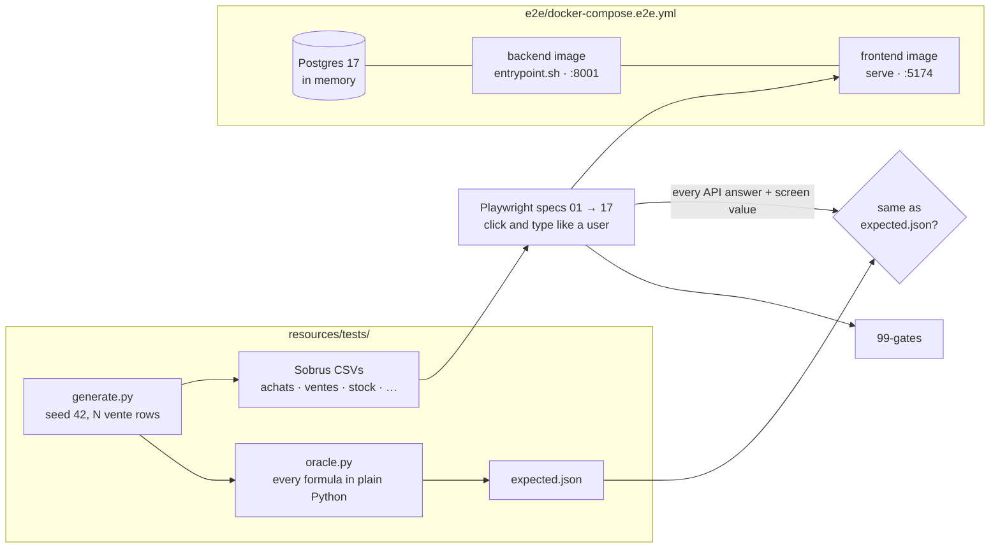

### 8.1 Run
| Command | What |
|---|---|
| `make tests` | every test, headless. Asks: vente rows (default 100 000, min 1 000), only last failures?, record a new speed baseline? |
| `make tests 99` · `make tests 06 15` | only those files (number or part of the name); setup 01-02 always first |
| `make tests-ui` (or `make tests-ui ventes`) | a real maximized browser plays them, slowed down |

Each run: generate data → build + start the Docker stack (own project `apcm-e2e`, fresh database) →
Playwright → stack removed. After the run, a summary: tests, checks, oracle values compared, user
actions, API calls.

### 8.2 Test data (`resources/tests/generate.py`)
Deterministic products `E2E PRODUIT 00000…`, achats (≈ rows / 3), ventes, stock, a « liste » file,
2 400 extra achats (cancel / delete tests), 5 catalogue rows. On purpose, like the real files:
3 lines of each file repeated, 1 bought product in 4 also bought from a 2nd supplier, 40 lines per file
and 1 stock expiry in 25 with hand-typed dates. `oracle.py` never imports app code.

### 8.3 Specs (`e2e/tests/`)
| Spec | Covers |
|---|---|
| 01-admin-setup · 02-import | admin creates « Pharmacie E2E » + owner; owner imports achats, ventes, stock |
| 03-rapport · 04-alertes · 05-stock | every tile and table value × Mixte / Pharmacie / Parapharmacie, dialogs, exports |
| 06-ventes · 07-achats | columns, sorts, search + suggestions, filters, gauges, export |
| 08-analyses | every mode × type, search, liste, export |
| 10-exclusions · 11-comptabilite | exclude / reintegrate, Comptabilité numbers, payments, export |
| 12-equipe · 13-compte · 14-admin | team, account + passwords + sessions, admin pages and drill-down |
| 15-imports | history, cancel, delete, delete several at once, interrupted, damaged file, hand-typed dates, 2 imports at once |
| 16-layout | FR ⇄ ES, theme, sidebar, « Session expirée » |
| 17-inscription | sign-up (5 screens), admin « Demandes »: accept a new pharmacy + an employee by code, refuse an unknown code / a used email, logins |
| 99-gates | **coverage** (every `/openapi.json` route called, store allowlisted) · **speed** vs `e2e/perf-baseline.json` (route ≤ max(×1.2, +50 ms), FLOW ≤ max(×1.35, +150 ms)) · **error codes** equal front ⇄ back · **0 react-hooks lint errors** |

### 8.4 When a test fails
- `e2e/test-results/<test>/error-context.md`: the error + a page snapshot (read this first); trace and
  video beside it.
- HTML report `e2e/report/`; time per route `e2e/.results/slowest.txt`; backend log (with the password
  links) `e2e/.logs/backend.log`.
- Helpers in `e2e/lib/`: `ui.ts` (`setPeriod`, `pageCall` = the page's own GET, `pageSend`), `diff.ts`
  (field-by-field compare, tolerance 0.02), `checks.ts` (one checker per payload), `fixtures.ts`
  (records every `/v1` call).

---

## 9. Deployment (DigitalOcean)

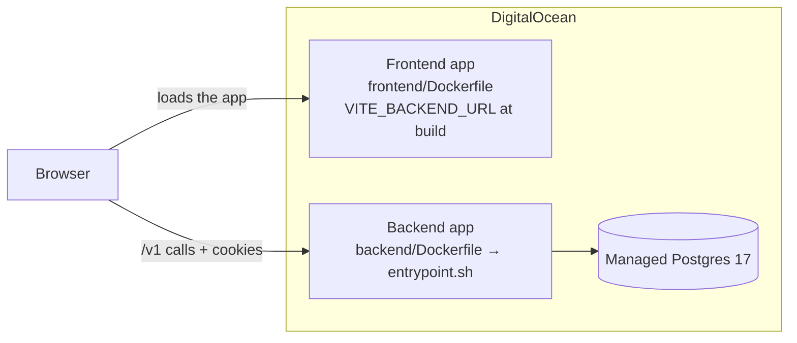

The backend container boots like this (same in the demo and the E2E stack):

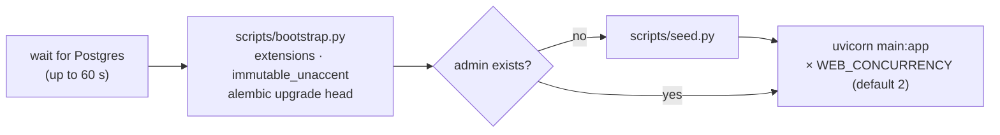

- Set every var of `backend/.env.example` on the backend: `COOKIE_SECURE=true`, a real `JWT_SECRET`,
  `FRONTEND_URL` = the deployed frontend origin, SMTP. Never `RATE_LIMIT=0`.
- Migrations run at each deploy (no manual SQL). A failed migration fails the deploy; DigitalOcean keeps
  the previous version running. Replay a new migration locally on Postgres 17 first.
- The exact DO app spec (domains, sizes) is **not in the repo**: ask the owner.
- Next production steps (static site, `pg_stat_statements`, caches, workers): `PLAN.md` §3.

---

## 10. How-to checklists

**Add a backend endpoint**
1. Route in the right `app/<area>/router.py`; guard in the signature (`member("…")`, `OwnerDep`,
   `AdminDep`).
2. Shapes in that area's `schemas.py`. Errors: `raise ApiError(status, ErrorCode.X, "French detail", **params)`;
   a new code → same value in `frontend/src/api/errors.ts` + `errors.<code>` in `fr.ts` and `es.ts`.
3. Heavy SQL → `*_queries.py` (pure function: `(db, filters) → dict`).
4. Frontend: entry in `api/api.ts` (`{url, key}` or `{url, refreshes}`), type in `types/<area>.ts`, hook
   in the page's `hooks.ts`.
5. E2E: call it from the UI and check every field against the oracle (the coverage gate fails otherwise).

**Add a page**: route in `App.tsx` (+ `RequireFeature` / `RequireRole`), nav entry in
`_components/AppLayout.tsx`, `Page` + page folder ([§6.3](#63-where-things-go)), texts in `fr.ts` **and**
`es.ts`, a spec.

**Add a DB column**: model + Alembic migration (idempotent); functions used by indexes schema-qualified
(`public.unaccent`); test on Postgres 17.

**Change a formula**: ask the owner → change the backend → change `resources/tests/oracle.py` the same
way → `make tests`.

**Before a commit**: `make format`, type-check clean
(`cd frontend && npx tsc -p tsconfig.app.json --noEmit`), `make tests` green.
